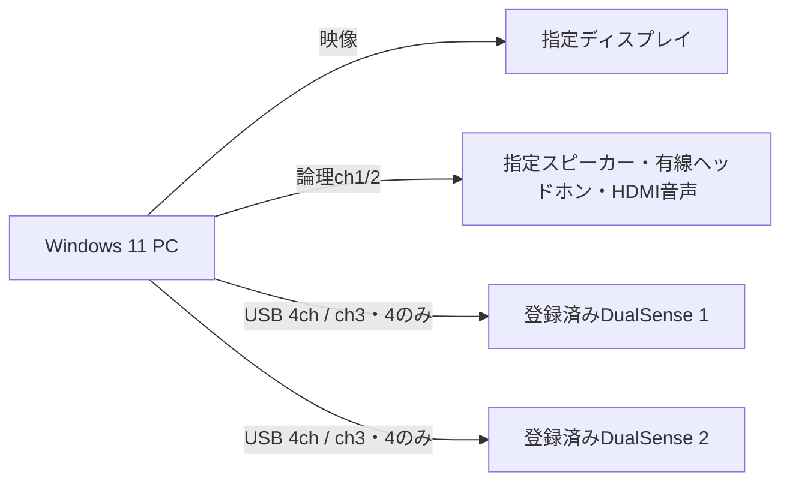

# スタッフ操作手順

## 2回目以降の起動

デスクトップの「DualSense Player」をダブルクリックします。コントローラーと表示先を接続し、アプリで「再生 / 再開」を押してください。保存された動画の一覧と機器設定を読み込み、一覧の先頭から再生します。インストール用のPowerShellコードを再実行する必要はありません。

起動用ファイルは `DualSense Player.lnk` です。削除した場合は `scripts/Create-Launcher.ps1` で作り直せます。直接起動する場合は、導入先の `app` フォルダーにある `DualSensePlayer.Supervisor.exe` を使います。

## 接続

DualSenseをUSB接続し、Windowsの出力形式が48kHz・4chになっていることを確認します。標準DualSense（VID 054C / PID 0CE6）は音声出力とHIDを照合します。HIDを検出できない場合も、使用する4ch音声出力を手動で選択できます。Windowsの既定音声出力は本アプリから変更しません。

## 初回登録

最初に1台だけ接続し、管理画面上部の「機器を再検出」を押します。「DualSense 1」で、Windowsプレーヤーで振動した「Wireless Controller」などの4ch音声出力を選択してください。25%の強度で「左テスト（ch3）」「右テスト（ch4）」を行って実物に台番号を付けます。1台だけならDualSense 2は未使用のままで構いません。2台使う場合は次の機器を接続して同じ手順で登録します。同じ出力先やContainer IDの機器を2枠には保存できません。

強度・通常音声の音量は0〜100%で調整でき、現在値を数字で表示します。更新後も保存済みの強度を引き継ぎます。表示を確認し、25%から調整してください。ミュートと振動全停止も保持します。

機器欄にはHIDを照合できたDualSenseと、48kHz・4chの音声出力を表示します。選択した出力先IDを優先し、再接続時は保存したContainer ID・シリアルと一致する一意の機器へ復帰します。表示名や接続順では割り当てません。HID初期化に失敗しても選択した音声出力へch3/4を送り、初期化の警告を診断ログに残します。交換機や識別不能になったUSBポート変更は、停止して明示的に再登録してください。3台目は自動使用しません。

通常音声を使わない場合は「未使用」を選択できます。通常音声の音量を0にする、またはミュートしても、振動は独立して動作します。

## 素材と再生

「動画を追加…」でMOV / MP4を複数選択します。動画やフォルダーを一覧へドラッグ＆ドロップすることもできます。「フォルダーを追加…」は直下のMOV / MP4をファイル名順に追加します。サブフォルダーは対象外です。まとめて追加した中に未対応・破損素材がある場合は、その追加を中止して該当ファイルを表示します。

一覧の「上へ」「下へ」で再生順を決めます。「一覧から削除」は選択した項目だけを外し、動画ファイル自体は削除しません。同じ動画を複数回配置することもできます。

各動画を一覧で選び、対象の4chトラックとch対応を指定します。標準では動画ch1/2を通常音声へ、動画ch3/4をDualSense ch3/4へ送ります。DualSense ch1/2は無音です。「動画ch3/4を振動に使う」で標準の対応へ戻せます。デコード順、映像・音声の開始PTS、尺、DC成分、ピークを確認します。ch対応はデコード側の1〜4を重複なく指定します。初回は同梱の `channel-check.mov` と `channel-check.mp4` を手動再生し、実際の経路を確認してください。「自動再生用」の確認済みは動画ごとに保存します。未確認でも手動再生ではch3/4を送信します。

「全動画を検証・先読み」で全動画のPCMを準備します。「再生 / 再開」で指定ディスプレイに全画面表示し、一覧の上から順に連続再生します。A・B・Cを並べた場合は、A → B → C → Aと繰り返します。「選択した動画から再生」はその動画の先頭から始め、以降は一覧の順に進みます。管理画面には現在の動画名・番号・動画内位置を表示します。

2画面では管理画面を別画面へ配置し、1画面では管理画面を隠します。動画ごとに解像度やfpsが異なっても、対応範囲内であれば連続再生できます。映像は縦横比を維持し、余白は黒帯になります。

1本は10分以内、プレイリストは最大100本です。PCMの先読み上限は合計2GiB（約46分）です。超過すると開始前にエラーを表示するため、動画を減らしてください。動画の切り替えで音声出力を作り直さず、全動画を同じ時計で再生します。素材自体に含まれる無音や黒フレームはそのまま再生します。

素材・再生順・ch対応・出力先・時刻補正・排他モードの変更は停止中のみ可能です。再生中も音量・各台の強度・個別ミュート・振動全停止は操作できます。DCやピークの警告が出ても波形を自動修正しません。振動出力の上限は初期値0.8で、100%強度はこのプロジェクトの設定上限です。

通常音声と各台の補正は−500〜＋500ms、1ms単位です。正値で出力を遅らせ、負値で先行させます。負値の分は開始時の先読み待ち時間を増やします。実機測定に基づいて校正してください。

一時停止は位置を保持し、通常音声と振動を止めます。停止はプレイリストの先頭へ戻します。スライダーと時間表示はプレイリスト全体の位置です。シークはスライダーで位置を選び、シークボタンで確定します。再生中のシークは再生を続け、一時停止中はその位置の映像を表示します。

## 停止とキー

| 操作 | 結果 |
|---|---|
| Ctrl+Shift+M | 展示を続けて管理画面を表示 |
| Ctrl+Shift+H / 振動全停止 | 映像・通常音声を続け、2台の振動を停止。保存され、明示解除まで維持 |
| 展示全停止 / 停止 | 全出力を停止し、先頭へ戻る。自動復旧でも再開しない |
| Ctrl+Shift+Q / 終了 | 確認後に全出力を停止して正常終了 |
| Esc / Space | 来場者画面では再生を変更しない |

キー操作はアプリにフォーカスがある場合に有効です。来場者画面にはUSB警告を重ねず、カーソルは無操作3秒で隠れます。デコード障害時だけ「ただいま調整中」を表示します。

## 切断と復帰

片方または両方のDualSenseが切断されても映像と通常音声は継続します。登録済み機器が戻るとHID初期化をやり直し、現在位置から50msのフェードインで参加します。再試行間隔は1〜5秒です。振動全停止中は接続が戻っても無音を維持します。

通常音声の切断では、その出力だけを停止して登録済み機器を待ちます。別の既定機器には転送しません。指定ディスプレイの切断では音声と振動も止め、指定画面の復帰後に先頭から再開します。スリープ復帰も、直前に運転中だった場合のみ再初期化して再開します。

「送信中」とch3/4のメーターはソフトウェア上の状態です。機械的振動の検出結果ではありません。振動しない場合は、出力先が未選択になっていないか、強度が0%か、ミュート・振動全停止中かを各台の表示で確認してください。再生中に管理画面が隠れているときは `Ctrl+Shift+M` で開きます。毎日の始業時に左右テストと動画1周を実施してください。

## 無人運転と保存

無人運転では `DualSensePlayer.Supervisor.exe` を使います。監視はUIと映像再生の進捗を確認し、5秒の停滞で旧プロセスツリーを終了して再起動します。初回起動の猶予は15秒、再起動上限は10分間に3回です。超過すると保守待ちになります。正常終了では再起動しません。

「Windowsログイン時に起動」は、現在のユーザーのRunキーへ監視プログラムを登録します。自動ログイン、復電時起動、Windows更新、OS全体のキオスク制限は展示PC側で設定してください。

設定とログは `%LOCALAPPDATA%\DualSenseExhibitionPlayer` に保存します。「設定を保存」、全動画の先読み、再生開始時に、再生順・動画ごとのトラック・ch対応・確認済み状態を保存します。起動時はこの順序を復元し、自動再生には全動画のch対応確認が必要です。旧版の単一動画設定は自動的に1本のプレイリストへ移行します。

`settings.json` は原子的に置換し、正常な前回版を `.bak` に残します。`haptics-stopped` と `exhibition-stopped` は停止状態の独立記録です。別PCでは出力機器を再登録します。

診断ZIPには設定・状態・ログだけを含めます。動画本体、マイク音声、画面録画は含めません。ログは30日または合計200MBを上限に削除します。

本番終了時は展示全停止を押してから終了してください。配布EXEはコード署名を付けていないため、Windowsの発行元確認が必要になる場合があります。

## 動画の追加・先読みでJSONエラーが出る場合

旧版では、日本語のフォルダー名や動画のメタデータを読む際、文字コードの違いにより `invalid escapable character within a JSON string` が出る場合がありました。修正版ではffprobeの出力をUTF-8で読み込みます。アプリを終了してからREADMEのPowerShell導入コードを実行すると、設定を保持して新しい版を導入し、デスクトップの起動用ファイルも更新します。JSONを手作業で編集する必要はありません。
