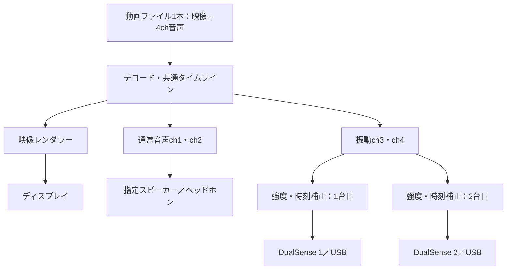

# DualSense展示プレーヤー 開発仕様書

版：1.0 ／ 作成日：2026年10月29日

**4ch音声を内包した動画ファイル1本を読み込み、ディスプレイの映像、通常音声、USB接続した2台のDualSenseのハプティクスを同期させ、展示中は繰り返し再生するWindowsアプリ。**

別の振動専用WAVは不要。動画のch1・ch2を通常音声、ch3・ch4を左右グリップの振動として扱う。音から振動を自動生成する機能も不要とし、動画内に制作済みの振動波形をそのまま利用する。

本書は開発・見積もり用仕様である。Windows、動画内4ch音声、ディスプレイへの映像表示、USB接続のDualSense 2台、連続ループを確定要件とする。chの用途、対応形式、初期値、性能目標は以下の提案仕様とし、素材サンプルと対象機のPoCで確認する。性能値は実測結果やメーカー保証値ではない。

## 1. 利用シーンと基本構成

来場者2人がそれぞれ1台のDualSenseを持ち、同じディスプレイの映像を見ながら同じハプティクスを体感する。再生開始や周回ごとのスタッフ操作は不要とする。

| 構成要素 | 仕様 |
|---|---|
| PC | 専用Windows 11 PC、64bit、SSD。メモリ16GBを目安とし、最低性能はPoCで確定 |
| コントローラー | ソニー製標準DualSense 2台。データ通信対応USBケーブルで接続 |
| 映像 | 選択したディスプレイに全画面表示 |
| 通常音声 | スピーカー、有線ヘッドホン、HDMI音声など指定した1つの出力先 |
| 振動 | 同じ左右の振動波形を2台へ配信。強度・時刻補正は台ごとに設定可 |
| 素材 | 4ch音声を内包したローカル動画1本 |
| 運用 | オフライン、自動開始、無限ループ、USB切断後の復帰 |
| 管理画面 | 第2画面があれば常時表示。1画面でも管理操作に対応 |

初期範囲にはBluetooth、DUALSHOCK 4、DualSense Edge、3台以上、アダプティブトリガー、プレイリスト、ネット動画、来場者操作による分岐、2台で異なる振動素材の再生、遠隔管理を含めない。通常音声を無音にした展示も可能とする。

## 2. 4ch音声の割り当て

### 2.1 素材内の論理チャンネル

| 動画内の論理ch | 内容 | 出力先 |
|---|---|---|
| ch1 | 通常音声・左 | 指定スピーカー／ヘッドホンのL |
| ch2 | 通常音声・右 | 指定スピーカー／ヘッドホンのR |
| ch3 | 左グリップの振動波形 | 1台目・2台目の左グリップ |
| ch4 | 右グリップの振動波形 | 1台目・2台目の右グリップ |

通常音声の出力にはch1・ch2だけを使い、4ch全体をステレオへダウンミックスしない。振動信号をスピーカーへ混ぜず、通常音声を振動信号へ混ぜない。

### 2.2 DualSense側のUSB出力

公開実装では、DualSenseのUSB音声を4ch・48kHzで扱い、ch3・ch4を左右グリップへ使用している。[R1] アプリは各台を独立した音声出力として開き、次の内容を送る。

| USB出力ch | 1台目 | 2台目 |
|---|---|---|
| ch1 | 0：無音 | 0：無音 |
| ch2 | 0：無音 | 0：無音 |
| ch3 | 動画の振動L × 1台目強度 | 動画の振動L × 2台目強度 |
| ch4 | 動画の振動R × 1台目強度 | 動画の振動R × 2台目強度 |

各台の補正値を適用した再生位置で波形を読み出す。コントローラーの内蔵スピーカー／イヤホン端子へ通常音声を出す機能は初期範囲外とする。

### 2.3 チャンネル順の検証

「4ch」という数だけで用途を決めない。コンテナやコーデックのチャンネルレイアウトにより、デコード後の並びが制作時の番号と異なる場合がある。例えば4.0とquadは異なるレイアウトである。[R7]

読み込み時にトラック、ch数、レート、レイアウト、デコード後の順序を表示し、デコードchから論理chへの対応を保存する。既定は1→1、2→2、3→3、4→4だが、初回は4chを順番に鳴らす試験動画で確認する。用途を推測して自動で並べ替えない。マッピング変更は停止中のみ許可する。

## 3. 入力動画の仕様

| 項目 | 初期仕様 |
|---|---|
| ファイル | ローカルのMOV／MP4 |
| 映像 | H.264、最大1920×1080、最大60fps、固定フレームレート |
| 尺 | 1本10分以内を初期検証範囲とする |
| 音声構成 | 1本の4ch音声トラックを基本とする |
| レート | 48kHz |
| 推奨制作形式 | MOV＋H.264映像＋4ch PCM音声、16bitまたは24bit |
| MP4での入力 | 4ch AAC-LC音声に対応する。実際の書き出し設定とサンプルでチャンネル順・波形・ループを検証 |
| 多重音声 | 4chトラックが複数ある場合はスタッフが対象を選択。2chトラック2本の自動結合は初期範囲外 |

PCMは、制作した振動波形を非可逆圧縮せず格納するための推奨であり、別の音声ファイルを要求するものではない。MP4も動画1本で完結する。MOV／MP4の拡張子だけでは内部形式を保証しないため、読み込み時に実際のコーデックとch数を検査する。[R8]

素材の音声PTS、映像PTS、開始オフセット、AACのエンコーダー遅延・末尾パディング等をデコーダーの情報に従って扱い、最初の音声パケットを無条件に映像時刻0へ置かない。映像の表示タイムラインを1周の長さとし、音声の空白区間は無音、範囲外の末尾は打ち切る。意図しない長さ差や開始差は読み込み結果に表示する。

2ch素材、未対応形式、破損ファイルは開始前にエラー表示する。4chがない場合に通常音声から振動を自動生成してはならない。4Kや上記以外のコーデックは追加対応とする。

## 4. 再生経路と機能

アプリが映像と4ch音声を一括管理する。Voicemeeter、VB-CABLE、DSX等は動作の必須条件にしない。Windows全体の音声を取り込まないため、通知音や他アプリの音声は振動経路に入らない。

| ID | 機能要件 |
|---|---|
| PLAY-01 | 動画、トラック／ch対応、表示先、音声出力先、2台の設定を保存・復元する |
| PLAY-02 | 自動再生が有効なら起動後の検証・先読みを経て、全画面で先頭から開始する |
| PLAY-03 | 再生、一時停止、停止、先頭から再生、管理画面からのシークに対応する |
| PLAY-04 | 動画末尾で無限ループする。映像・音声・2台の振動を同じ周回時刻で折り返す |
| PLAY-05 | 一時停止は映像を保持し、通常音声・振動を停止。再開は同じ位置から同期して行う |
| PLAY-06 | 停止は再生位置を先頭へ戻す。停止・シーク時は旧出力キューを破棄し、以前の振動を後から出さない |
| PLAY-07 | 通常音声の音量と各台の振動強度を独立させる。音声ミュートでも振動は継続できる |
| PLAY-08 | 映像は縦横比を維持して全体表示。必要に応じて黒帯を付ける |
| PLAY-09 | コントローラーのボタン操作で再生や設定を変更しない |
| PLAY-10 | 運転中はスリープ・画面消灯を可能な範囲で抑止し、終了時に解除する |

## 5. 同期、ループ、波形の扱い

### 5.1 同期方式

動画内に4ch音声があっても、ディスプレイ・通常音声・2台のUSB出力の遅延は同一ではない。素材の時刻と実機の出力時刻を共通タイムラインに結び付ける。

高精度の単調増加時計と音声機器の再生位置を使い、UIタイマーだけで同期しない。WASAPIのIAudioClockは機器の再生位置とQPCに対応する値を取得できる。[R4] デバイスごとのクロック差を監視し、バッファ制御と微小リサンプリング等で追従させる。各出力は独立した読み取り位置を持ち、1つの消費型ストリームを奪い合わない。

映像も共通時刻に追従させる。開始、シーク、再接続時は、実際に表示／出力される時刻を基準に先読みして準備する。「複数のプレーヤーへ同時に再生命令を送るだけ」の実装は採用しない。

### 5.2 オフセット

通常音声と各DualSenseに−500〜＋500ms、1ms刻みの補正を設定できる。正値はその出力を遅らせ、負値は先行させる。負値は先読みと映像を含む全体の開始待ち時間で実現する。

初回開始時に前周の振動を出さない。連続ループ時は補正分が周回境界をまたぐ場合も正しい素材位置を参照する。設定は停止中のみ変更可とする。

### 5.3 ループ

累積時刻と周回数を保持し、素材の読み出し位置だけを1周の長さで折り返す。先頭映像とPCMを先読みし、各出力が独立した終了通知でループしないようにする。AACのパディング等をそのまま追加の無音として周回に足さない。

目標はアプリ起因の黒フレームなし、余分な映像停止1フレーム以内、連続する試験波形の音声・振動断10ms以内。素材自身の先頭・末尾にある黒画面や不連続は区別する。映像や振動の自動クロスフェードで演出内容を変更しない。

### 5.4 振動強度と停止

| 項目 | 仕様 |
|---|---|
| 台ごとの強度 | 0〜100%。初回25%から確認し、検収済み値を保存 |
| 波形加工 | 自動EQ、低音抽出、自動正規化をしない。指定強度と出力上限のみ適用 |
| 入力検証 | DC成分や過大ピークを診断表示。制作波形を無断で補正しない |
| 出力上限 | クリップを防ぐ制限値を設ける。100%はプロジェクトの設定上限であり、機器の保証値ではない |
| 再接続 | 現在位置から短いフェードインで復帰。初期値50ms |
| ミュート | 台ごと、および2台一括 |
| 振動全停止 | 動画・通常音声を継続し、振動だけを止めるスタッフ操作 |

振動全停止は明示解除まで保持し、ループ、USB再接続、アプリ自動再起動で解除しない。正常動作時は操作受付から100ms以内の停止を目標とする。音声供給が途絶えた場合は無音を供給し、最後の波形を無期限に反復しない。

## 6. 機器識別と切断復帰

「Wireless Controller」という表示名やUSB検出順で台番号を決めない。音声エンドポイントID、PnPのContainer ID、利用可能なシリアル情報でHIDと音声出力を対応付ける。[R5][R6] USBポート変更で識別情報が変わる場合も考慮する。

初回は1台ずつ登録し、「1台目をテスト」「2台目をテスト」で実機を照合する。同じ機器を2枠に割り当てない。必要なHID初期化と音声ハプティクスのモード設定を、起動時と再接続時に行う。従来型ランブルや他の機器制御ソフトとの競合はPoCで確認する。

| 発生した状態 | 要求動作 |
|---|---|
| 1台切断 | 映像・通常音声・残り1台を継続。切断台のキューを破棄 |
| 2台切断 | 映像・通常音声を継続。スタッフ画面に振動待機を表示 |
| 登録済みの同じ台が復帰 | 再検出・初期化・先読みを行い、動画の現在位置へ合流 |
| USBポート変更で照合不能 | 勝手に他の枠へ割り当てず、スタッフが再登録 |
| 未登録の交換機 | スタッフが空き枠に明示登録 |
| 3台目接続 | 未使用機器として表示し、自動利用しない |
| 振動全停止中の再接続 | 接続だけ復帰し、振動は停止のまま |

OSがHIDと音声出力を利用可能にしてから5秒以内の復帰を目標とする。USB列挙に要した時間は別計測とする。再試行は1秒から開始し、失敗が続いた場合は最大5秒間隔にする。

「接続済み」「ストリーム稼働中」はソフトウェアの確認状態であり、実際の機械的振動を検出した表示ではない。始業時の左右テストは別途必要とする。

## 7. 来場者画面とスタッフ画面

来場者画面は動画のみを表示する。無操作3秒でカーソルを隠し、通常のUSB警告・管理UI・デバッグ表示を重ねない。映像を再生できない重大障害時だけ「ただいま調整中」の画面に切り替える。

| スタッフ画面の領域 | 表示・操作 |
|---|---|
| 素材 | 動画ファイル選択、映像／音声形式、4chマッピング、検証結果 |
| 再生 | 開始、一時停止、停止、先頭から再生、現在位置、シーク、周回数 |
| 表示・音声 | 出力モニター、通常音声出力先、音量、補正値 |
| 1台目／2台目 | 登録機器、接続・出力状態、強度、補正値、信号メーター、左右テスト、個別ミュート |
| 運用 | 自動再生、ログイン時起動、設定保存、稼働時間、警告、診断ログ出力 |
| 停止操作 | 振動全停止、展示全停止 |

第2画面がない場合は専用キーで管理画面を開く。初期案はCtrl＋Shift＋M＝管理画面、Ctrl＋Shift＋H＝振動全停止、Ctrl＋Shift＋Q＝終了確認。アプリにフォーカスがある場合の動作を保証範囲とする。

管理画面を開いても展示を続ける。再生中は音量・強度・ミュートのみ変更でき、素材、ch対応、機器割り当て、補正値は停止して変更する。管理画面を閉じている間はEsc／Space単独で停止しない。Windows全体のキオスク制限は別途設定とする。

## 8. 障害復旧と無人運転

| 障害 | 動作 |
|---|---|
| 動画の欠損・破損・ch不足 | 開始前検証で停止。ファイル名と原因をスタッフに表示 |
| 通常音声出力の切断 | 映像・振動を継続し、登録出力の復帰待ち。別の既定機器へ自動転送しない |
| DualSenseの占有・形式不一致 | 該当台だけ停止・再試行。4chを2chへ落として再生しない |
| バッファ不足 | 該当出力を無音にし、現在位置へ再同期してログ記録 |
| ディスプレイの切断 | 音声・振動を停止。指定画面の復帰後に先頭から再開 |
| 動画のデコード失敗 | 全出力を停止して調整中画面へ移行し、再オープンを試す |
| スリープから復帰 | 全出力を再初期化。前回運転中の場合のみ先頭から再開 |
| アプリ異常終了／ハング | 別の監視プロセスが旧プロセスを終了させて再起動 |
| 設定破損 | 前回正常版を復元。復元不能なら設定待ち |

監視はUIだけでなく再生処理の進捗を確認する。異常終了の検出から15秒以内の再起動を目標とし、ハング判定は5秒を初期値とする。再起動前に旧プロセスを停止し、二重再生を防ぐ。

自動再起動は10分間に最大3回とし、超過時は保守待ちにする。通常終了、展示全停止、振動全停止の意図を保存し、監視が勝手に解除しない。音声処理は有限バッファとし、強制終了後に古い振動が残り続けないことを実機試験する。OSやUSBドライバー自体が停止した場合の停止時間はアプリ単独の保証対象外とする。

オフラインで動作し、開発環境のインストールを必要としない。通常運転は標準ユーザー権限とする。Windowsログイン時のアプリ起動は任意設定とし、自動ログイン、復電時起動、OS更新時刻は展示PC側で管理する。

## 9. 設定、ログ、技術方針

動画ファイル以外に、アプリ設定をJSON等で保存する。これはスタッフが手作成する素材ではなく、管理画面の操作でアプリが作成する。動画差し替え時は停止して再読み込みする。

保存対象は動画パス／ハッシュ、対象音声トラック、ch対応、出力機器ID、モニター、音量、台ごとの強度・補正値、自動再生設定、停止状態。素材に属する設定とPC固有の機器設定を分け、別PCに移した際は機器を再確認する。設定は一時ファイルから置き換え、前回正常版を保持する。

ログには起動・終了、素材検証、周回、切断・復帰、出力形式、バッファ不足、同期統計、自動再起動、例外を記録する。上限は30日または合計200MB。診断出力に動画本体、マイク録音、画面録画を自動添付しない。

| 実装対象 | 推奨方針 |
|---|---|
| UI | Windowsネイティブ。C#／サポート対象.NET LTS／WPFを第一候補 |
| デコード | FFmpeg等で映像と4ch PCMを取り出し、PTSとch構成を維持。採用版・配布条件を確認 |
| 出力 | WASAPIで通常音声と2台のUSB音声を独立管理。[R3] |
| 機器管理 | MMDevice、PnP、必要なHID通信 |
| 同期 | 共通時刻、IAudioClock、出力ごとのキュー、遅延・クロック差補正 |
| 監視 | 再生アプリと独立した小さな起動・監視プロセス |

一般的な動画プレーヤー部品で全音声を自動出力した上で振動を追加する構成は避け、音声はch分離後だけ出力する。音声コールバックをファイルI/O・UI処理・ログ書き込みで待たせない。共有モードを第一候補とし、4ch維持と同期性能のため排他モードが必要ならスタッフ設定として明示する。Windowsの既定出力先を無断で変更しない。

## 10. 性能目標と受入試験

以下はPoCで達成可否を確認する初期目標。展示PC、ディスプレイ、DualSense、ケーブル／ハブ、通常音声機器の構成を固定し、型番・ファームウェア・OSビルドを記録する。

| 指標 | 合格目標 |
|---|---|
| 2台間の振動開始差 | 絶対値の95パーセンタイル10ms以下、最大20ms以下 |
| 映像イベントと振動開始差 | 校正後の絶対値の95パーセンタイル30ms以下、最大50ms以下 |
| 映像と通常音声のイベント差 | 校正後の絶対値の95パーセンタイル40ms以下、最大60ms以下 |
| 連続運転 | 本番動画で24時間、停止・クラッシュ・音声バッファ不足0回 |
| 長時間同期 | 開始／1h／8h／24hで同期目標を満たし、ずれが累積しない |
| メモリ | ウォームアップ1h後から24h後の安定状態で100MB超の純増がなく、増加傾向が継続しない |

| ID | 試験 | 確認内容 |
|---|---|---|
| AT-01 | 4ch経路 | 各chだけに信号を入れた動画で、通常音声L/Rと両台の振動L/Rが正しく分離。ch3/4が会場音声へ出ない |
| AT-02 | 素材形式 | MOV／PCMとMP4／AACの検証素材で、ch順、開始位置、末尾、実振動を確認 |
| AT-03 | 同期 | 各30回以上のイベントを計測し、上記同期目標を満たす |
| AT-04 | ループ | 30秒の試験動画を1,000周。黒画面、追加振動、境界での蓄積ずれがなく、5章の途切れ基準を満たす |
| AT-05 | 連続運転 | 24時間の性能・メモリ・同期目標を満たす |
| AT-06 | USB抜き差し | 各台10回、2台同時5回。残りの出力を止めず、登録済み実機が現在位置へ復帰 |
| AT-07 | 停止・シーク | 各20回。古い振動が出ず、振動全停止が再接続・再起動でも解除されない |
| AT-08 | 出力先変更 | 通常音声・ディスプレイの切断時に8章どおり動作し、別機器へ誤出力しない |
| AT-09 | 強制終了・ハング | 振動が残り続けず、二重再生なしで復旧。再起動回数上限と通常終了を正しく扱う |
| AT-10 | 不正素材・設定 | 2ch動画、破損動画、未対応形式、壊れた設定を検出。音声からの振動生成へ切り替えない |
| AT-11 | オフライン | ネットワーク無効でも全機能が動作し、PC再起動後は設定どおり起動 |

同期計測用の動画には、同じPTSに画面の明滅、通常音声パルス、左右の振動パルスを入れる。ディスプレイの光センサー、2台のグリップに固定した振動センサー、通常音声の信号を同じ収録時計で測ることを原則とする。検出閾値、センサー位置、音声の測定位置を固定する。ソフトウェアログだけでは表示遅延と機械的遅延を検収したことにはしない。

## 11. 開発順序、納品物、当日の操作

| 段階 | 完了条件 |
|---|---|
| 1：技術PoC | 実際の4ch動画で、ch分離、2台の4ch出力、HID初期化、識別、同期、抜き差し復帰を確認 |
| 2：基本再生 | 全画面表示、共通時刻再生、無限ループ、停止・シーク、強度・遅延調整 |
| 3：展示運用 | 管理画面、保存、自動開始、監視・復旧、ログ |
| 4：検収 | 展示機材で受入試験を実施し、補正値・素材形式・既知の制約を確定 |

PoCには実際に展示で使う書き出し方式の短い動画を用いる。未達があれば原因と対応案を示し、同期基準やch分離を無断で緩和しない。

納品物：実行パッケージ、ソースコードとビルド手順、4ch試験動画、スタッフ操作手順、接続図、検収結果、採用ライブラリとライセンス一覧、既知の制約一覧。

当日の操作：機器接続 → アプリ起動 → 2台の左右テスト → 動画を1周して確認 → 全画面の展示運転。終了時は展示全停止で音声・振動を止めてからアプリを終了する。

着手時に確定する項目は、動画の実際のコンテナ／コーデック／chレイアウト、PCとディスプレイ、通常音声出力、DualSenseの型番・ファームウェア、USB接続構成、動画の尺、振動強度、同期目標の実測結果とする。別WAVの制作やファイル間同期は要求しない。

## 12. 技術資料

参照日：2026年10月29日。コミュニティのDualSense実装はソニー公式のWindows向けAPI仕様ではない。以下は実現方式の根拠であり、本書の性能目標を保証しない。

- [R1：DualSense Haptic Designer — USBの4ch音声とハプティクス](https://github.com/Jellybit/DualSense-Haptic-Designer)
- [R2：Dualsense-Multiplataforma — 複数台への音声ハプティクス実装](https://github.com/gilsonreis/Dualsense-Multiplataforma)
- [R3：Microsoft — About WASAPI](https://learn.microsoft.com/en-us/windows/win32/coreaudio/wasapi)
- [R4：Microsoft — IAudioClock::GetPosition](https://learn.microsoft.com/en-us/windows/win32/api/audioclient/nf-audioclient-iaudioclock-getposition)
- [R5：Microsoft — Device Properties](https://learn.microsoft.com/en-us/windows/win32/coreaudio/device-properties)
- [R6：Microsoft — USB ContainerIDs in Windows](https://learn.microsoft.com/en-us/windows-hardware/drivers/usbcon/usb-containerids-in-windows)
- [R7：FFmpeg — Channel Layout](https://ffmpeg.org/ffmpeg-utils.html#Channel-Layout)
- [R8：FFmpeg — Formats](https://ffmpeg.org/ffmpeg-formats.html)
